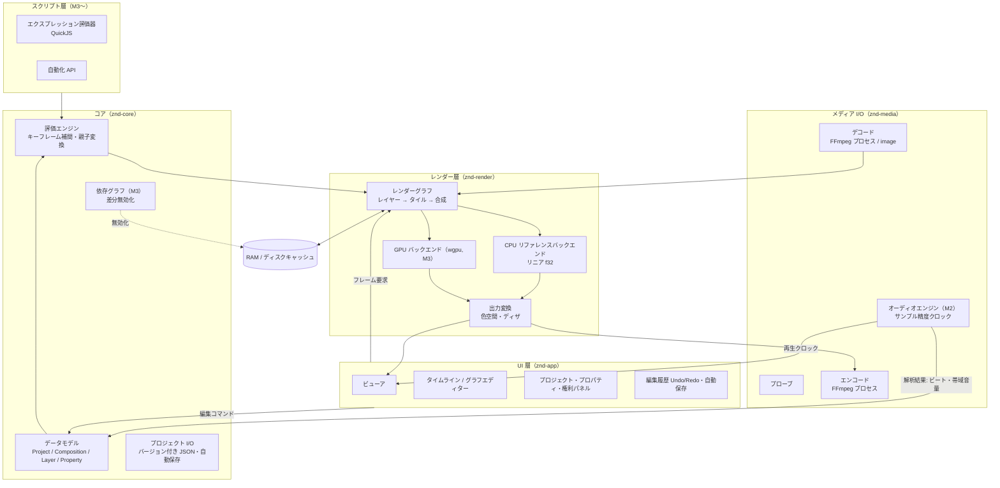

# 1. 全体アーキテクチャ

対象ユーザー（少人数・1〜5 分の短編・劇場上映・締切直前の追い込み）から導いた優先順位
「音同期 ＞ テキスト ＞ 重ね掛けでも快適なプレビュー ＞ 上映画質 ＞ 堅牢性」を、層の切り方にそのまま反映する。

## 層構成

## クレート

| クレート | 役割 | 依存 |
|---|---|---|
| `znd-core` | データモデル、時刻、プロパティ評価、プロジェクト I/O、権利・共同制作・制作ログ | serde |
| `znd-text` | フォント探索、シェーピング、行分割、縦書き、ルビ | core, rustybuzz, fontdb |
| `znd-render` | 合成、ベクター描画、マスク、エフェクト、3D、出力変換、フレーム指紋、品質チェック | core, text, rayon, gltf |
| `znd-audio` | ミキシング、タイムストレッチ、解析、ラウドネス | core, render |
| `znd-script` | エクスプレッション、自動化スクリプト | core, text, render, rquickjs |
| `znd-gpu` | エフェクトの GPU 実装（wgpu） | core, render, wgpu |
| `znd-media` | プローブ、フッテージ・音声の供給、書き出し、素材管理、提出前チェック | 上記, image, FFmpeg（外部プロセス） |
| `znd-cli` / `znd-app` | コマンドラインとアプリ | 上記すべて（app は eframe, rfd, cpal） |

レンダラーはエクスプレッションと音声を直接は知らず、`Resolver`・`AudioWindow` というトレイト越しに受け取る。
UI を持たないクレートだけで書き出しまで完結するので、バックグラウンドレンダリングや自動テストは UI なしで動く。

**GPU バックエンド（`znd-gpu`）はエフェクトと合成を処理する。** CPU のレンダラーが常に「正解」で、GPU はそれと同じ結果を出す。
レンダラーは `EffectAccel`（エフェクト）と `CompositeAccel`（合成、`gpu_composite.rs`）のトレイト越しに GPU を呼ぶ。
合成では、GPU に載せられるレイヤー（平面・フッテージ・プリコンポで、マスク・マット・モーションブラーが無く、エフェクトが GPU 対応）は
ソースと置き方を送り、それ以外は CPU で出力空間のタイルにしてから送って、重ねる処理だけを GPU で行う。
3D レイヤー・調整レイヤーのあるコンポは CPU で合成する。

## 設計上の決定と理由

### 時刻は整数（flicks）
1/705,600,000 秒単位の `i64`。23.976〜60fps の全プリセットと 44.1/48/96kHz のサンプル周期を割り切るので、
フレーム境界とサンプル境界の両方を誤差なしで表せる。**音ハメが最優先機能である以上、時刻に浮動小数は使わない。**

### 内部はリニアライト・32bit float・プリマルチプライド
加算やグローを重ねても階調が破綻せず、大スクリーンでのバンディングを避けられる。
出力時に ±0.5LSB のディザを掛けて 8bit へ落とす（8bit で正確に表せる値は動かさないので黒は浮かない）。
従来ツールの見た目に合わせたい場合のために、表示ガンマ空間での合成もプロジェクト設定で選べる。

### CPU リファレンス実装を先に作り、GPU はそれと比較して検証する
仕様は「GPU ネイティブのレンダーグラフ」だが、M1 では CPU 実装のみを提供する。理由:

1. 参照画像テストの「正解」を、ドライバーや GPU 機種に依存しない決定的な実装で定義する必要がある。
2. 劇場上映用の最終書き出しは、速度より再現性が重要。CPU 実装は最終出力のフォールバックとしても残す。
3. M1 の機能（平面・フッテージ・プリコンポ・描画モード）では CPU でも 1/2 解像度でリアルタイムに届く（下記実測）。

エフェクト多段は CPU では間に合わないので、エフェクト 29 種を wgpu で実装した（CPU の結果と自動テストで比較）。合成はまだ CPU。
レイヤーを「出力空間のタイル」にしてから合成する現在の構造は、タイル＝テクスチャに置き換えればそのまま GPU に載る。

### FFmpeg はリンクせず外部プロセスとして使う
FFmpeg（LGPL/GPL）と x264（GPL）を本体にリンクすると本体のライセンスが縛られる。
パイプで生フレームをやり取りする方式ならその問題がなく、ユーザーが自分の FFmpeg ビルド
（NVENC / VideoToolbox / QSV / AMF 対応）を差し替えられる。代償はシーク時のプロセス起動コストで、
連続読み出しの再利用とフレームキャッシュで吸収する。プロセス境界の越境コストが問題になる用途
（多数の動画素材の同時スクラブ）は、M2 でプロキシ自動生成により解決する。

### プロジェクトファイルは人が読める JSON
配列順を保ち、既定値のフィールドは出力しない。同じプロジェクトは常に同じバイト列になる（テストで保証）ので、
git 等での差分管理・2〜3 人でのマージがしやすい。保存は一時ファイル＋rename で、書き込み中に落ちても壊れない。

### 編集は必ず 1 つの入口を通す
UI からの変更はすべて `App::edit` を通り、取り消し履歴・自動保存フラグ・プレビュー無効化が一括で処理される。
M1 の履歴はプロジェクト全体のスナップショット（短編規模では十分軽い）。M5 でコマンド差分方式にして履歴パネルを付ける。

## プレビューの流れ

1. UI スレッドは編集のたびにプロジェクトの不変スナップショット（`Arc<Project>`）とリビジョン番号を公開する。
2. プレビュースレッドは「現在フレーム → その先のフレーム」の順に、複数フレームを並列にレンダリングして RAM キャッシュに積む。
3. ビューアはキャッシュにあるフレームだけを表示する。再生は実時間で進み、未キャッシュ区間は直前の絵を保持する。
4. キャッシュのキーはフレームの内容ハッシュ（そのフレームに存在するレイヤーの定義と、時刻に依存するかどうかから作る）。
   編集しても、影響の無いフレームのキャッシュは生き残る。

## 実測性能（CPU バックエンド、M1 時点の計測）

`znd bench`（1080p、半透明・回転・キーフレーム付き平面 200 枚、描画モード 5 種混在）、Apple Silicon（高性能 4 + 高効率 4 コア）:

| 解像度 | 複数フレーム並列（RAM プレビュー） | 1 フレームずつ（スクラブ） |
|---|---|---|
| 1/2 | 約 27 ms/フレーム（36 fps） | 約 50〜80 ms |
| フル | 約 140 ms/フレーム（7 fps） | 約 150〜220 ms |

目標「1080p・200 レイヤーで 1/2 解像度がリアルタイムに近い」は、**エフェクトなしの条件では** RAM プレビューで達成。
エフェクト多段を含む条件は M3（GPU）の受け入れ基準とする。

## 実装不能・非現実的な箇所と代替案

| 要件 | 問題 | 代替案 |
|---|---|---|
| AE エクスプレッションの「高い互換性」 | 文法は JS だが、AE 固有オブジェクトモデルが膨大。完全互換は非現実的 | 仕様に列挙された関数群＋使用頻度の高い API を互換テスト付きで実装。未対応 API は行番号付きエラーで明示 |
| FBX 読み込み | 公式 SDK は再配布条件付きのプロプライエタリ | MIT の `ufbx` を使う。対応外の機能は glTF への変換を案内 |
| Alembic | 公式ライブラリ（C++/HDF5/Ogawa）への依存が重い | Ogawa 形式のみ対応。カメラ・メッシュキャッシュに限定 |
| ロトブラシ相当の AI セグメンテーション | 学習済みモデルのライセンスと配布サイズ | Apache-2.0 の SAM 2 系モデルを ONNX Runtime で実行。モデルは初回ダウンロード。GPU 必須 |
| 3D カメラトラッカー | 商用品質のソルバーは単独で大規模開発 | 特徴点追跡＋バンドル調整の基本実装（M4）。難しいショットは外部ソフトのカメラデータ取り込みで補う |
| オプティカルフローのフレームブレンド | 品質と速度の両立が難しい | GPU 上の階層型フロー。破綻時はフレームミックスへ自動フォールバック |
| AI / PDF のベクター保持 | AI は非公開形式 | PDF 互換で保存された AI のみ対応（一般的な保存設定）。それ以外は SVG 書き出しを案内 |
| PSD のレイヤー保持 | 調整レイヤー・スマートオブジェクト等は再現不能 | ラスターレイヤー・グループ・描画モード・不透明度・マスクまで対応。非対応要素は読み込み時に一覧で警告 |
| ProRes 出力 | FFmpeg の実装は Apple の認証を受けていない | macOS では VideoToolbox（純正）を優先。他 OS は `prores_ks` とし、その旨を書き出し画面に表示 |
| H.264/H.265/AAC | 特許プール。エンコーダーの同梱は配布者にライセンス義務が生じうる | エンコーダーは同梱せず、ユーザー環境の FFmpeg / OS のハードウェアエンコーダーを使う |
| OpenFX 互換 | ホスト実装は可能（BSD）だが、プラグイン側が特定ホストを前提にしていることが多い | フィルター系の画像エフェクト API を実装（[06-plugins.md](06-plugins.md)）。動作確認は公式サンプルのみ |
| ACES | 完全な ACES パイプライン（RRT/ODT 全種） | OpenColorIO（BSD）を組み込み、設定ファイルで対応 |
| タイムラプス録画 | OS の画面収録権限が必要 | アプリ自身のウィンドウ内容だけを低頻度で保存（権限不要） |
